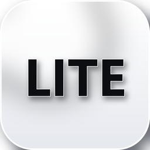
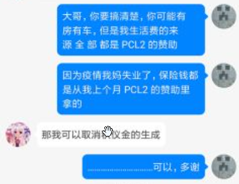
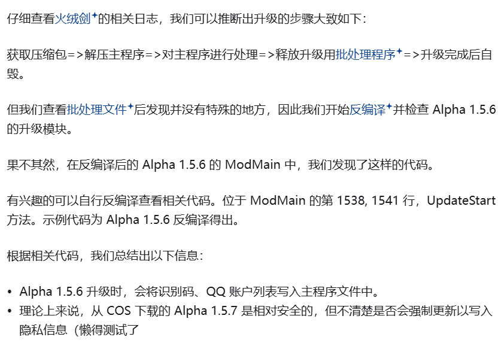

[简体中文](README.md) | **English** | [繁體中文](README-ZH_TW.md)

# PCL Lite

Preface: PCL and its guard squad keep saying we "touched the cake", and hand out labels while they're at it. I'd like to know — does this hat factory have some grudge against the bakery? How come the hat factory is the one always touching the cake?
[A mysterious article, courtesy of cubk](https://github.com/askbbtsk/pcl-lite/blob/main/readmedlc.md)

[Source repository](https://github.com/askbbtsk/pcl-lite) |
[Download](https://github.com/askbbtsk/pcl-lite/releases) |
[Documentation](docs/) |
[License](#-license) |
[Submit issues](https://github.com/askbbtsk/pcl-lite/issues/new/choose) | [Issue guide](docs/ISSUES.md)

> **NOT AN OFFICIAL MINECRAFT PRODUCT.** NOT APPROVED BY OR ASSOCIATED WITH MOJANG OR MICROSOFT.
> 非 MINECRAFT 官方产品。未经 MOJANG 或 MICROSOFT 批准，也不与 MOJANG 或 MICROSOFT 关联。

PCL Lite is an independent Minecraft launcher project, with extensive changes and fixes on top of its open-source base.

This project is released under the **MIT License** with additional copyleft terms — see [License](#-license).

**Do not use this project if you are located in mainland China.**

## 📦 Download

Get the latest build from [Releases](https://github.com/askbbtsk/pcl-lite/releases).

| Architecture | File | Notes |
|---|---|---|
| x64 | `PCL-Lite_[version]-[tag]_x64.exe` | Single file, no extraction needed |

`[tag]` is one of `pre`, `snapshot`, `nightly`, or `hotfix` (a patch on the stable release, e.g. `1.6.0-hotfix-1`). Builds without a tag are stable releases.

- Requires the [.NET 10 Desktop Runtime](https://dotnet.microsoft.com/download/dotnet/10.0)
- The launcher updates itself from this repository's Releases
- Pre-release versions (e.g. `0.1.0-beta`) are treated as the beta channel by the updater

## 💻 Supported Platforms

| Operating System | Support Status | Requirements |
|---|---|---|
| Windows 10 1809 (17763) or later | ✅ Fully supported | [.NET 10 Desktop Runtime](https://dotnet.microsoft.com/download/dotnet/10.0) |
| Windows 8 to Windows 10 1809 (17763) | ⚠️ Expected to run; support offered at discretion | [.NET 10 Desktop Runtime](https://dotnet.microsoft.com/download/dotnet/10.0) |
| Windows 7 or earlier | ❌ Not supported | N/A |
| macOS / Linux / Other OS | ⚠️ Cross-platform development only (cross-compilation) | [.NET 10 SDK](https://dotnet.microsoft.com/download/dotnet/10.0) |

**✅ Fully supported**: we will provide as much support as possible, but you must ensure you are using the latest version of the launcher.

**⚠️ Expected to run; support offered at discretion**: PCL Lite should run on these platforms, but full functionality is not guaranteed. You may need to upgrade to a fully supported OS version to receive further support.

**❌ Not supported**: PCL Lite is barely usable on these platforms and may not even launch. Please upgrade your OS to use PCL Lite.

**⚠️ Cross-platform development only (cross-compilation)**: PCL Lite's source code can be built on macOS and Linux, but cannot run there directly. As a developer, you can develop on these platforms and then move the build output to Windows for testing.

**Note**:
Only the latest version of the launcher is supported.
Depending on the nature of certain issues (e.g. an incomplete system environment), you may still need to upgrade your OS to keep receiving support.
PCL Lite always recommends using the latest version of your OS for the best experience.
You can still try PCL Lite on unsupported systems, but you may run into many additional problems.

## 📖 Documentation

> The documents below are currently written in Simplified Chinese.

| Document | What it covers |
| --- | --- |
| [docs/README.md](docs/README.md) | Index, project layout, where the version number actually lives |
| [Theming & colours](docs/THEME.md) | How the eight-step palette is computed, the 14 presets, custom themes, adding a new preset |
| [Config & data directories](docs/CONFIG.md) | Where the config files are, editing them by hand, migration logic |
| [Discord Rich Presence](docs/DISCORD.md) | What is shown, privacy boundaries, switching to your own Discord app |
| [Build & release](docs/BUILD.md) | Compiling, secret injection, signing, publishing a release |
| [Azure login](docs/AZURE-LOGIN.md) | Registering an app from scratch to sign in with your own client_id |
| [MCP](docs/MCP.md) | Letting AI clients drive the launcher directly |
| [Open-source inventory](docs/CREDITS.md) | Where the code came from, third-party libraries, and their licenses |

## 🔒 License

This project is released under the **[MIT License](LICENSE)** with the additional **copyleft** terms below. The [LICENSE](LICENSE) file is authoritative.

- **Copyleft**: any modified version, derivative work, or redistribution must be distributed under this same license (MIT + these additional terms); no other license may be used
- **Attribution required**: the copyright notice and author credit must be retained in full, and must not be removed or replaced
- **Modified distributions must be labelled PCL Lite**: if you distribute a modified version, its name or description must clearly identify the project as **PCL Lite**
- **Not affiliated with Mojang / Microsoft**: this project has no relationship with Mojang Studios, Microsoft, or their affiliates, and is not approved, authorized, or endorsed by them
- **Regional restriction**: do not use this project if you are located in mainland China
- **License may change**: this license may be updated at any time without prior notice; updates apply only to versions obtained afterwards, and **already forked or already distributed versions are unaffected**

**Portions ported from third parties carry their own licence**: the Bedrock Edition support
(download + install + launch) is ported from
[PCL-Symbio-Edition](https://github.com/Hydrogen-Peroxide/PCL-Symbio-Edition), and that part remains
under **Apache-2.0** (per its clause 4). The full text is in [`LICENSE-APACHE`](LICENSE-APACHE).
It covers only the ported code and does not change the licence of the project as a whole.
A complete inventory of code sources and third-party libraries is in
[the open-source inventory](docs/CREDITS.md).

## ❤️ Credits

Reference: https://zhuanlan.zhihu.com/p/347828430

Thanks to this person.
Postscript: Longmao, you dumbass — can you please stop milking money out of themes?

## Funny Area

I didn't know Ah Q's surname was Zhao!

## Star History

<a href="https://www.star-history.com/?repos=askbbtsk%2Fpcl-lite&amp;type=date&amp;legend=top-left">
  <picture>
    <source media="(prefers-color-scheme: dark)" srcset="https://api.star-history.com/chart?repos=askbbtsk/pcl-lite&amp;type=date&amp;theme=dark&amp;legend=top-left" />
    <source media="(prefers-color-scheme: light)" srcset="https://api.star-history.com/chart?repos=askbbtsk/pcl-lite&amp;type=date&amp;legend=top-left" />
    
  </picture>
</a>
