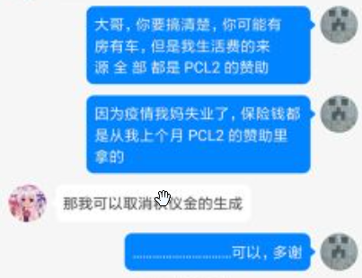
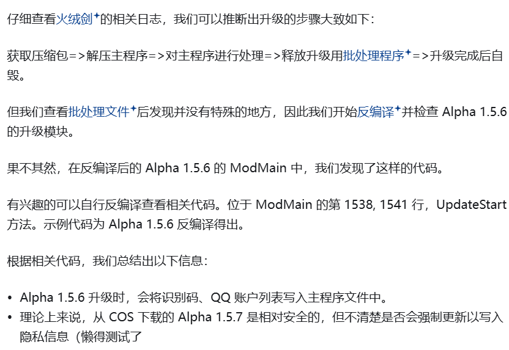

[简体中文](README.md) | [English](README-EN.md) | **繁體中文**

# PCL Lite

前言：pcl 和它的護衛隊天天說動了蛋糕，順手扣帽子，我想知道 pcl 這個帽子工廠和烘焙店是有仇嗎 怎麼帽子工廠天天動蛋糕？
[神祕文章來自 cubk](https://github.com/askbbtsk/pcl-lite/blob/main/readmedlc.md)

[下載](https://github.com/askbbtsk/pcl-lite/releases) |
[文件](docs/) |
[授權條款](#-授權條款) |
[提交問題](https://github.com/askbbtsk/pcl-lite/issues/new)

> **非 MINECRAFT 官方產品。** 未經 MOJANG 或 MICROSOFT 批准，也不與 MOJANG 或 MICROSOFT 關聯。
> NOT AN OFFICIAL MINECRAFT PRODUCT. NOT APPROVED BY OR ASSOCIATED WITH MOJANG OR MICROSOFT.

PCL Lite 是基於 PCL 開放原始碼開發的衍生版本，在上游功能的基礎上加入了一些額外的改動與修復。

本專案以 **MIT 授權條款** 發布，並附帶傳染性（copyleft）附加條款，詳見[授權條款](#-授權條款)。

**中國大陸使用者請勿使用。**

## 📦 下載

前往 [Releases](https://github.com/askbbtsk/pcl-lite/releases) 下載最新版本。

| 架構 | 檔案 | 說明 |
|---|---|---|
| x64 | `PCL-Lite_[version]-[tag]_x64.exe` | 單一檔案、免解壓縮 |

`[tag]` 為 `pre`、`snapshot`、`nightly` 或 `hotfix`（熱修復，如 `1.6.0-hotfix-1`）；沒有 tag 的是穩定版。

- 需要已安裝 [.NET 10 桌面執行階段](https://dotnet.microsoft.com/download/dotnet/10.0)
- 啟動器內建自動更新，更新來源指向本儲存庫的 Releases
- 預發布版本（如 `0.1.0-beta`）會被更新通道視為 beta 通道

## 💻 支援平台

| 作業系統 | 支援情況 | 環境要求 |
|---|---|---|
| Windows 10 1809 (17763) 或更高 | ✅ 完整支援 | [.NET 10 桌面執行階段](https://dotnet.microsoft.com/download/dotnet/10.0) |
| Windows 8 - Windows 10 1809 (17763) | ⚠️ 理論能跑，酌情提供支援 | [.NET 10 桌面執行階段](https://dotnet.microsoft.com/download/dotnet/10.0) |
| Windows 7 或更低版本 | ❌ 不支援 | / |
| macOS / Linux / 其他作業系統 | ⚠️ 僅跨平台開發支援（交叉編譯） | [.NET 10 SDK](https://dotnet.microsoft.com/download/dotnet/10.0) |

**✅ 完整支援**：盡可能提供一切相關支援，但必須確保啟動器為最新版本。

**⚠️ 理論能跑，酌情提供支援**：PCL Lite 應該可以在這些平台上執行，但不保證功能完全可用。你可能需要升級到完整支援的系統版本以獲得進一步支援。

**❌ 不支援**：PCL Lite 在這些平台的可用性較低，甚至根本打不開。請升級作業系統以使用 PCL Lite。

**⚠️ 僅跨平台開發支援（交叉編譯）**：PCL Lite 的原始碼可以在 macOS 與 Linux 平台編譯，但無法直接執行。作為開發者，你可以在這些平台上進行開發，然後將編譯產物轉移到 Windows 系統測試。

**註**：
僅對最新版本的啟動器提供支援。
取決於部分問題的特殊性（如系統不完整），有時你仍然必須升級作業系統以繼續獲得支援。
PCL Lite 始終建議使用最新版本的作業系統以獲得最佳體驗。
你仍然可以嘗試在不受支援的系統上使用 PCL Lite，但可能會遇到很多額外問題。

## 📖 文件

| 文件 | 講什麼 |
| --- | --- |
| [docs/README.md](docs/README.md) | 索引、專案結構、版本號在哪裡 |
| [主題與配色](docs/THEME.md) | 八級色階怎麼算、14 個預設、自訂主題、怎麼新增主題 |
| [設定與資料目錄](docs/CONFIG.md) | 設定檔位置、手動改法、遷移邏輯 |
| [Discord 狀態顯示](docs/DISCORD.md) | 顯示內容、隱私邊界、換成自己的應用程式 |
| [建置與發布](docs/BUILD.md) | 編譯、金鑰注入、簽章、發版 |
| [Azure 登入](docs/AZURE-LOGIN.md) | 從零註冊應用程式，用自己的 client_id 走正版登入 |
| [MCP](docs/MCP.md) | 讓 AI 用戶端直接操作啟動器 |
| [開源專案清單](docs/CREDITS.md) | 程式碼來源、第三方函式庫、各自的授權條款 |

## 🔒 授權條款

本專案以 **[MIT 授權條款](LICENSE)** 發布，並附帶下列**傳染性（copyleft）附加條款**。完整條款以 [LICENSE](LICENSE) 檔案為準。

- **傳染性**：任何修改版、衍生版或再分發版，必須同樣以本協議（MIT + 附加條款）分發，不得改用其他授權條款
- **必須署名**：必須完整保留本專案的版權聲明與作者署名，不得刪除或替換
- **二次修改須標註 PCL Lite**：修改後分發時，必須在名稱或說明中明確標註本專案為 **PCL Lite**
- **與 Mojang / Microsoft 無關**：本專案與 Mojang Studios、Microsoft 及其關聯公司沒有任何關係，未獲其批准、授權或背書
- **地域限制**：中國大陸使用者請勿使用
- **協議可變**：本協議可能隨時更新，且不提前通知；更新只對之後取得的版本生效，**已經 fork 或已經分發的版本不受影響**

**第三方移植部分另有授權條款**：基岩版（下載 + 安裝 + 啟動）移植自
[PCL-Symbio-Edition](https://github.com/Hydrogen-Peroxide/PCL-Symbio-Edition)，該部分仍受
**Apache-2.0** 約束（依據其第 4 條），全文見 [`LICENSE-APACHE`](LICENSE-APACHE)。
它只涵蓋移植來的那部分程式碼，不改變本專案整體的授權條款。
完整的程式碼來源與第三方函式庫清單見[開源專案清單](docs/CREDITS.md)。

## ❤️ 致謝

參考文獻：https://zhuanlan.zhihu.com/p/347828430

感謝這個人
後記：龍貓你個傻逼能不能不要用主題圈錢啊
