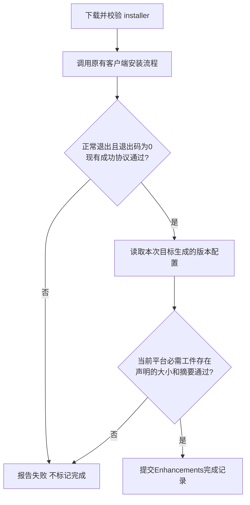
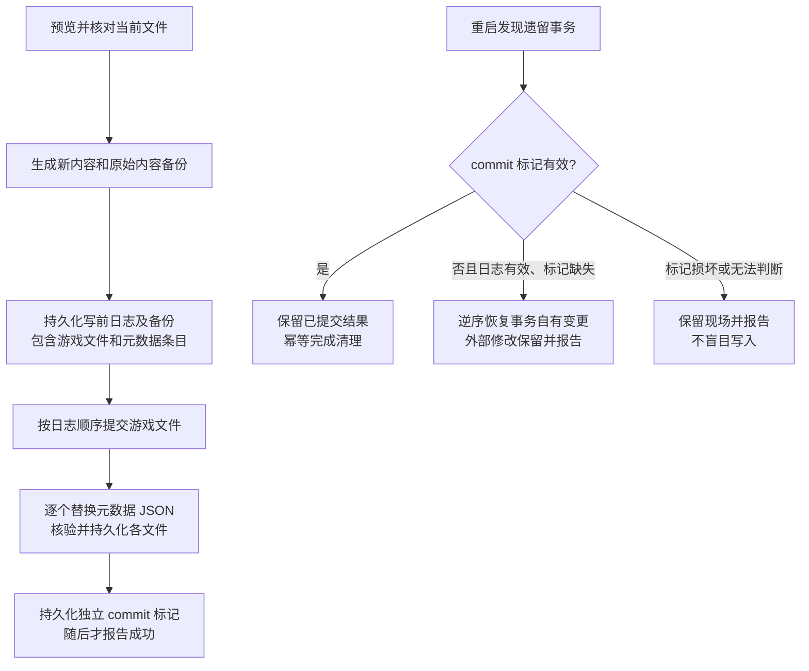

# PCL Lite 实例管理增强计划

> 状态：阶段 A–E 的本轮实现已分批提交 dev；支持范围、后续非目标及人工验收边界见第 10 节。
> 实现基线：PCL-CE 中现有 PCL Lite，沿用当前实例、安装、启动、配置、联网授权及文件管理制度。
> 核心定位：借鉴 Prism 的组件与来源管理，增强现有能力；不重写启动器，不替换现有读写制度。
> 本文替代原“实例管理综合体”草稿；旧稿的单一真相切换、新游戏根目录和强制重建启动引擎不再作为实施要求。

## 1. 用户要求与不可突破的边界

当前落地记录：

- 首批：增强目录导出过滤及回归测试已提交，远端 CI 通过。
- 阶段 A：辅助声明/报告 schema、独立存储、当前有效库清单的只读体检、可重建 resolved 缓存；实例概览的“实例体检”入口；两个独立默认开启的启动流程设置与证据式加载器标注。提交 f4468f66 的远端单测及双架构构建通过。
- 阶段 B：模组页选中项存为本地集合，浏览/刷新集合并预览复制到当前实例；保留来源、路径别名和禁用后缀，逐项报告冲突/链接/占用/取消。Windows 原生路径查询的运行时封送兼容问题经 CI 暴露并修复；2c96583a 的单测与双架构构建通过。实际复制与 Lite 启动使用共享根目录协调，不宣称可锁定其他启动器。
- 追加 Lunar 修复：旧会话退出/停止/输出和 IPC 回调按代次隔离，结束日志附 PID；6f5d2ed7 的回归测试和双架构构建通过。日志中的旧游戏停止不再覆盖新游戏状态。
- 阶段 C 本批：游戏文件和外置来源记录进入同一写前日志，独立 commit 标记与幂等恢复；现有更新入口接入，启动恢复不续跑下载。Forge 包装器同时要求退出码 0 与原成功标记。体检可显式仅补缺失运行库，不覆盖损坏文件。显式测试副本生成新增强身份，丢弃旧解析缓存及未完成事务。
- 第三个默认开启的设置已接入：按实例记忆原版按键/鼠标设置，与旧跨版本同步共用预览和写入协调；首次不覆盖、差异经确认，可靠正常退出才记录。启动器在游戏后直接退出时没有驻留观察者，无法捕获该次退出设置；旧记忆保留，PID/启动时间记录用于阻止其他 Lite 会话在游戏存活时改写。
- 事务边界：最后哈希核对与文件替换之间不提供针对任意外部进程的系统级 compare-and-swap。共享协调锁约束合作的 Lite 操作，发现外部变化保留并报告。清理被中断可留下惰性 .completed-tx-*，不重新恢复或扩大递归删除范围。
- 阶段 C 修正后的 7a2bafcf 远端单测和双架构构建通过。
- 阶段 D：在现有“修改实例”页新增独立跨加载器迁移预览，保持源 MC 为默认目标，可选择 Fabric/Forge/NeoForge；仅以同项目明确支持目标的版本生成候选。逐项取消候选、可选内容默认不复制，未知项报告。原安装器在独立暂存目标安装，目标 Java 重选；禁用后缀保留，源输入复核，通过产物/依赖检查后才发布新目录。03c684ea 的 782 项单测和双架构构建通过；真实下载与游戏启动仍需人工回归。
- 文件级复用先用于迁移：候选构建与已验证源摘要相同则复制，不同才走现有下载器。没有新增二进制差分包或保证所有整合包格式免去完整包下载。
- Java 约束已从原生启动方法按原顺序提取为共用方法，迁移和 Prism 导入调用同一规则；CI 对搬迁前后的语法逐条核对，只允许将当前选中实例引用改为方法参数。4e716de6 的远端验证通过。
- 阶段 E：Prism 实例目录只读导入、实际 mods/config/options 文件及组件差异对比、重复增强身份报告、单实例解析缓存清理；迁移/导入暂存目录继续排除出导出包。报告补齐声明/实际摘要、输入来源证据及平台/Java 身份摘要，不持久化原始认证参数。代码提交 12d3cb4d 的最终 CI 42655816446 通过。
- 最终验证：806 项单测通过；TestAll 插件构建、x64/ARM64 主程序构建、四种条件下源码契约及共享 Java 规则核对、1000 行文件门禁全部通过。CI 产物名为 PCL2_CE_CI_x64 / PCL2_CE_CI_ARM64，测试结果一并保留在该工作流附件中。
- 本轮未新增的后续/非目标仍按第 8 节：自动世界版本库、全实例原子升级、服务端自动覆盖同步不实施；环境分享自动重建、专用差分包和作者侧 CI 发布工具留待另行授权，不能算成本次已完成。
- 本地只进行源码/差异/XML 检查；游戏与 GUI 仍需人工回归，构建与单测由 GitHub CI 执行。

- 不动用户原有修改，不自动把配置或文件恢复成作者/整合包原版；现有文件优先。
- 普通扫描、浏览、打开实例和启动，不因增强信息缺失、损坏、过期或断网而受阻。
- 只有用户明确发起安装、复制迁移、更新或应用变更，才修改对应目标游戏内容；展示、分析与预览不改游戏文件和用户配置，允许生成或重建本计划定义的派生缓存。
- 保留现有游戏根目录、versions 结构、版本 JSON、Setup.ini、mods/config/saves 和隔离配置；不自动搬实例，不创建新的 .pcllight 游戏根目录。
- 不恢复自动备份、内部回收站、全实例强制原子升级或完整 Lite 的精简模式。
- 无自建服务器；元数据使用现有公开源，继续走当前授权、下载、镜像/PROXY、进度和取消机制。
- 只在用户显式导入时只读访问 Prism 实例或导出包；不写 Prism 数据，不把 Prism 的缓存作为本机运行依赖。
- 源码、配置和文档通过 Codex 自带补丁程序修改，供 Codex 差异审查；禁止用脚本直接重写。终端用于只读分析、补丁调用、Git 与必要验证。
- 不在 C 盘反复跑本地构建/全套测试；必要临时内容放 E 盘，完整验证交给 GitHub CI。
- 实施提交只推 dev，不自动合并 main、不发布。后续另有明确授权时才改变。

## 2. 增强记录与现有读写兼容

### 2.1 数据位置和权威关系

- 实例内 PCL/Enhancements/instance.json 记录识别出的组件声明、来源、禁用状态和用户显式选择；它是辅助声明，不取代现有版本 JSON 或 Setup.ini。
- 同目录 resolved.json 是可审计的解析报告/缓存，不是实例“必须长成这样”的强制清单，不授权修复器覆盖用户文件。
- 体检的权威判据是现有版本 JSON 经原有继承、补丁合并及当前平台规则处理后的有效配置和 libraries 声明；resolved.json 仅用于缓存解析、展示和差异对比，不是第二份权威清单。
- resolved.json 缺失、损坏或指纹过期时，按当前实例的实际输入重新解析并生成缓存，不因缓存丢失降低体检能力，也不按旧缓存重建游戏实例。输入不足或缺少权威摘要的项如实标为无法确认，不能编造完整清单或校验通过。
- 元数据缓存放现有 Paths.SharedLocalData 下的 meta-pcl-lite；界面展示状态放现有启动器数据区的 ui-state。继续使用原有 libraries、assets 和 Java 位置。
- 可重建派生缓存与包含用户选择的辅助声明分开处理：前者可重建，后者损坏时保留原文件，不猜测丢失的身份、来源或用户选择。未知 schema 保留原文件，不进行猜测性覆盖；resolved.json 可在内存或独立的当前 schema 缓存中重新解析。重建采用暂存后替换，并核对输入指纹；输入在解析期间变化则丢弃该次结果。缓存写入失败不影响内存中的体检结果和原有启动流程。
- 外部 PCL 或用户修改版本文件、配置、补丁、模组后，旧增强结果作废；下次显式增强操作重新核对，不自动覆盖。
- 不把稳定 UUID、基线主键迁移或目录重排作为首轮使用前提。显式克隆若已有增强身份，为新实例分配新身份；发现外部复制的身份冲突先报告，不能按路径长短认定原件。

### 2.2 组件识别范围

- 首轮覆盖原版、Fabric、Forge、NeoForge现有稳定链路；其他现有加载器继续原流程，增强层识别不到不得降低原支持。
- Quilt 不在本轮新增完整安装支持；现有不支持的入口明确拒绝，不静默忽略组件后宣称导入成功。
- 复用现有安装器、版本合并和本地补丁处理；保留顺序、未知字段、禁用记录和来源信息。
- 新增强层不在普通启动时重新应用 patches 或自动刷新远程 meta；显式操作时才解析和抓取必要内容。
- 元数据能表达当前引擎实际需要的库、条件、natives、参数、客户端工件和资产引用；不能仅凭 mainClass/libraries 的简化声明替代完整安装。
- 安装处理器继续由原安装链路执行；不把 installer 内嵌 version.json 直接当成已安装结果。

### 2.3 important、dependencyOnly、disabled

三个独立布尔分别保存，不压缩成互斥枚举；全部八种布尔组合允许记录。

| 字段 | 语义 |
| --- | --- |
| important | 删除时提供保护和明确确认；不等于强制启用 |
| dependencyOnly | 普通组件列表默认不展示；完整列表、诊断及依赖报告仍可看到 |
| disabled | 不参与有效组件解析，但记录、版本、补丁和来源保留，可以重新启用 |

- important + dependencyOnly、disabled + important、dependencyOnly + disabled，以及三者同时为真均不因组合本身而报错。
- 不把 disabled 当删除，也不在导入/导出时过滤掉禁用声明。
- 启用组件依赖禁用组件时报告未满足，不静默启用、删除或改写原记录。增强报告不能自行改变现有启动行为。
- 普通变更保留组件应用顺序；无法可靠识别时显示未知，不伪造已验证结果。

## 3. 解析、缓存及安装完成条件

### 3.1 两层缓存与有效输入

- 组件识别指纹包含：实际版本文件、补丁内容与顺序、来源元数据摘要、适配器/解析器版本，以及影响解析的 Minecraft 版本、平台和架构。
- Fabric 等完整启动 profile 按 Minecraft + loader 版本建键；不能只按 loader 版本缓存不同游戏版本的结果。
- 组件识别缓存保存 Java 兼容条件；Java 选择仍复用当前选择器，不另建竞争的选择机制。
- 依赖 Java 的有效解析/启动结果缓存，额外包含所选 Java 主版本、架构、运行时身份/路径及可用性信息；条件涉及完整版本时使用完整版本。
- Java 兼容集合仍按集合成员资格判断，不将不连续 compatibleJavaMajors 粗化成一个连续区间。
- 先读取约束再选 Java，再建立 Java 相关有效结果指纹，避免选择器把自己的旧结果当输入形成循环。
- 文件、补丁、Java 或解析版本变化后相关缓存失效。缓存命中不能跳过必要的原文件变化检测。
- 不缓存账号令牌或可直接执行的机器专属命令；实际启动时读取当前路径、设置和账号状态。
- 固定版本已有数据可离线复用，普通启动不为增强元数据增加联网依赖。TTL刷新不能静默改变用户已安装环境。

### 3.2 参数、环境与可审计报告

- 保留现有参数生成和转义方式，不在本轮顺带更换 Arguments/ArgumentList 或引入新的命令行切词语义。
- 解析报告展示有效值及来源：实例、全局、默认、整合包、补丁。数组按当前顺序保存，不为好看而排序或去重。
- 环境变量按名称和值分别记录，值内空格不按命令行拆分；append/replace 或其他增强能力仅在有明确现有映射时接入，不改变旧配置行为。
- --dump-effective/诊断导出必须脱敏令牌、账号敏感值和环境变量秘密；分享报告不直接携带可用凭据。
- A/B验收比较规范化后的有序参数、classpath、工作目录和环境变量；机器根路径及运行期凭据用占位符处理，不能要求跨机器原始字符串逐字节一致。

### 3.3 Forge/NeoForge安装硬门槛

- 当前 Forge 包装器会根据日志尾部 true 判断成功，尚不能声称已验证退出码；需在释放 process 前读取并检查退出码。
- 保留现有安装器和成功协议，增强层只补产物复核，不替代安装器，不顺带新增服务端安装。
- 检查本次目标配置和当前客户端/平台必需工件，不要求其他OS或server工件。
- 有权威大小/摘要时校验；无摘要时检查存在性与可用性，不声称通过哈希验证。
- 旧版本残留或其他实例的产物不能让本次安装误报成功；缺文件、取消或处理器失败不得写入完成状态。

## 4. 模组集合、路径与复制迁移

### 4.1 集合只是记录位置

- 在 Paths.Data 下新增 ResourceCollections/，按集合记录原路径、名称、来源和可读状态，相当于把分散模组的索引集合起来。
- 不移动来源，不硬链接、不联接、不注入classpath，不把来源改成多个实例的共享运行目录。
- 实例继续从原 mods 目录加载。集合支持只读查看、定位、选择并显式应用到目标实例。
- 原路径失效标记为失效，用户修改只在索引中反映，不删除集合中其他记录。
- 导出给其他用户时不原样分发本机绝对路径；需要内容时走现有导出选择。

### 4.2 Windows去重和链接边界

- 普通路径规范化为绝对路径，统一分隔符和末尾目录分隔符，默认按 StringComparer.OrdinalIgnoreCase 比较，与现有PCL行为一致。
- 对已存在、可访问且祖先无链接的本地文件，可展开8.3短名；无法可靠展开则保留原记录并标记，不能丢失路径。
- 不能确认同一文件时不做破坏性合并。大小写敏感目录若出现不同实体，保留并提示歧义，不擅自挑一个。
- 集合允许记录符号链接/联接点及其祖先路径，标注“链接”；不递归扫描或读取其目标内容。
- 迁移/导出拒绝跟随链接，列入无法迁移报告；不因不能迁移而自动删索引。

### 4.3 迁移默认复制，源文件保留

- 明确目标实例后，先检查占用、读取权限、格式和目标冲突，显示可处理/无法处理项。
- 同名同内容跳过，计为已存在；同名不同内容不覆盖，计入无法迁移。
- 丢失、占用、无权限、链接、格式不支持及复制时来源变化：跳过该项并说明，不阻断其余可迁移项。
- 提交前后核对源内容，不能把变化中的文件误报为已复制成功。
- 取消后停止后续复制，只清理本任务未提交临时文件；保留已完成目标，不能误报全部成功。
- 结束用PCL弹窗汇总成功、已存在、失败，逐项列文件名和具体原因，提供复制报告。

## 5. 修改实例的延伸：同加载器升级与跨加载器迁移

跨加载器迁移纳入现有“修改实例/调整加载器”的延伸入口，不另造一套安装引擎；它不是仅替换 loader 字段。前述功能清单中它是第4项，第9项是增量更新包，两者有关联但不是同一能力。

### 5.1 目标和默认值

- 同loader升级保留现有入口与行为；跨loader选择新增独立预览，先支持Fabric、Forge、NeoForge受支持的目标。
- 跨loader默认生成新实例，来源实例始终不动；目标名称由用户确认，目标已存在且非空时拒绝覆盖。
- 本轮不新增跨loader原地覆盖选项。原版转模组实例复用现有创建/修改流程，不能破坏原实例。
- 目标默认保持原Minecraft版本；如果用户同时改变MC版本，按“MC版本 + loader”共同筛选，不只校验loader。
- 暂存时只复用来源的可迁移内容，不把来源合并版本JSON改几个字段冒充新loader；由现有安装器生成目标环境。
- 目标实例的 Java 由现有选择器按目标 Minecraft、loader、安装器和已知组件的兼容要求重新选择，不自动继承源实例固定的 Java 路径或选择结果；源实例的 Java 配置保持原样。用户明确选择复用某个运行时时，也必须通过目标兼容条件及架构检查；找不到兼容 Java 时提示处理，不能标记目标就绪。

### 5.2 模组识别和候选

- 本地哈希查询用于可靠识别Modrinth/CurseForge项目及版本，不能据此推断另一个同名项目是等价物。
- 仅把同一可靠项目下明确支持目标MC与loader的文件列为自动候选；无目标版本、项目未知、多候选不确定或发布信息不可用时列为待处理。
- 跨项目替代不自动映射；用户自行指定的替代文件需单独确认、展示来源，并经过当前文件校验。
- 通用/多loader文件只有本地声明或可信平台信息明确兼容时才能复用；不能仅按扩展名判断兼容。
- 禁用模组迁移后仍禁用；不把禁用当删除。用户额外添加但无法识别的文件保留在源实例，目标不自动加载。
- 目标依赖检查复用已有逻辑，确认新增必需依赖、版本条件和已知冲突。无法完成的项显示原因，不静默改别的模组来凑成功。

### 5.3 预览、配置和存档

- 展示目标MC/loader、可复用、需下载、仍禁用、待选择及无法迁移项，逐条允许取消候选。
- 原配置全部保留在源实例。目标默认不复制来源loader专用配置和未知mods配置；可在预览显式勾选复制，并提示不保证目标兼容，失败不回写来源。
- options.txt、资源包、光影等使用现有导出/复制规则和用户选择；不自动改引用或替用户删除设置。
- 存档默认不复制、不转换、不自动打开；用户选择复制时独立复制且源存档不动，遇到版本不兼容说明风险，不承诺可跨版本游玩。
- 通过目标预检后在独立暂存目录安装及复制，确认最终配置/必要工件后提交目标目录，来源保持原样。
- 用户已在预览中确认的部分迁移可生成目标，但结果必须列出遗漏；依赖等必需条件无法满足时不能把目标标为就绪。
- 下载失败、取消或运行期状态变化停止提交，保留来源，不删除或覆盖用户后来创建的目标目录。
- 最后弹窗列全部无法迁移文件/原因及目标位置，提供报告；安装成功不等于保证游戏必然能正常运行。

## 6. 更新、事务与中断恢复

- 所有变更先预览再执行；玩家新增/修改/删除默认保持，不自动清除“多余文件”或恢复有意删除的mod。
- 用户明确选择某项采用作者版本后才可替换；提交前重查文件，预览后变化则停止并要求重新预览。
- 对实际修改的配置/增强元数据，日志记录原始内容、摘要和预期新内容，与游戏工件一起纳入恢复范围。
- 两个JSON分别File.Move不构成联合原子提交；commitMetadata回调不能单独承担跨文件一致性。完成所有目标后写入明确提交状态。
- 采用写前日志：在第一次修改正式游戏文件或元数据之前，持久化所有待改路径、原文件是否存在、原始字节备份及其摘要、预期新内容摘要和操作顺序。新内容先在暂存区生成并核验；只有摘要没有原始内容不能用于恢复。
- 元数据使用带版本的 MetadataEntries（或具有明确类别的等价条目）纳入同一个 journal，不能让 commitMetadata 执行未登记的任意写入。路径必须限定在本事务明确允许的实例/游戏根目录中，拒绝越界和链接跳转。
- 日志、原始内容备份及暂存文件完成必要的 flushToDisk 后，才按 journal 顺序提交游戏文件和元数据；每次替换前复核当前内容与预期前态。各文件单独替换只提供该文件的替换边界，不声称跨文件同时原子可见。
- 所有正式文件写入并核验、持久化完成后，写入绑定事务 ID 与 journal 摘要的独立 commit 标记，刷新到磁盘后才报告提交成功；不能在元数据替换前把 journal 标成已提交。持久化能力以操作系统/文件系统保证为限，不宣称可抵御所有硬件故障。
- 重启恢复先校验日志、备份、路径和标记：有有效 commit 标记时保留已提交结果并幂等清理；无标记时按逆序恢复本事务已写入的内容，包括元数据。无法可靠读取日志、标记损坏或资料不足时保留现场并报告，不能猜测成功或盲目覆盖。
- 回滚逐项核对当前内容：仍是本事务写入的新内容才恢复原始字节，原先不存在且仍是本事务新内容的文件才可删除；已经是原内容的项跳过。出现第三种内容视为外部修改并保留，允许下次重复恢复而不再次破坏文件。提交标记一旦持久化，后续取消不再把已提交结果当作未完成事务回滚。
- 中断恢复只回滚本事务拥有的变更，不继续生成新文件、不续跑旧更新。
- 发现事务之外的新修改时保留它及恢复资料，停止自动覆盖并给说明。
- 旧journal保持可读，新增格式带版本；事务目录不作为用户可浏览的自动备份功能，不恢复自动备份入口。
- 占用检查覆盖实例、共享游戏目录和同时发生的安装/迁移任务；操作间使用相同目标锁，不能只在开始时检查一次UI状态。
- 新实例使用目标父目录内暂存 + 完成后Directory.Move的既有原则；已存在目标不覆盖，来源从不作为回滚删除对象。

## 7. Prism导入、现有导出和清理

- 显式导入时只读来源，复制到用户选定Lite目标；日常运行不读写Prism实例/缓存。
- 保留识别出的禁用、保护、依赖展示标志及补丁顺序；无法识别设置出报告，不伪装已支持。
- 保留既有ZIP/MRPACK、完整Lite、在线附带Light、Java打包和隔离选项；不在本轮改变交付格式或强制新启动引擎。
- Light仍按当前机制在线下载和校验，不内嵌进Lite；当前Light强制开启隔离的限制继续如实提示。
- 不导出令牌、机器路径索引、内部缓存、备份或未完成事务资料；作者明确选择的实际内容按现有规则保留。
- 清理入口仅扩展可重建增强缓存，不清理实例、mod集合、共享运行库或未完成恢复资料。
- 不宣称现有清理按钮已提供完整多进程锁；新缓存刷新/清理需用同一协调机制，避免删除正在使用的文件。

## 8. 全部12项功能讨论与取舍

| 原编号 | 功能 | 决定 | 限制与理由 |
| --- | --- | --- | --- |
| 1 | 实例体检 + 一键修复 | 优先增强 | 按现有有效版本 JSON 和 libraries 声明体检，resolved.json 可重建；用户发起修复后首轮仅补有权威来源的缺失运行库，损坏文件只报告，不覆盖、不删多余文件、不自动补回用户删的mod，不改options.txt |
| 2 | 克隆/快照 | 优先完善现有克隆 | 复用测试副本，克隆与恢复快照分开；本轮不增加自动快照。带Java不等于完整离线，还需libraries/assets齐全 |
| 3 | 实例差异对比 | 优先增强 | 比较实际组件、mods、配置及有效设置，先只读；不能只比较辅助声明后自动同步 |
| 4 | 跨loader模组迁移 | 纳入本计划第5节 | 是修改实例的辅助迁移扩展，默认新实例，可靠候选+逐项预览+失败弹窗，不保证全自动等价 |
| 5 | 依赖图/冲突检测 | 整合现有能力 | 复用Jar-in-Jar和启动前检查；组件图不是模组图，元数据只能说明已知依赖和冲突，不能预测所有崩溃 |
| 6 | 环境分享和复现 | 后续先做脱敏诊断 | 版本/hash/配置报告有用；自动重建复用整合包导入，未知本地文件和运行条件不承诺完全一致 |
| 7 | 自动世界版本化 | 不做 | 用户已明确移除自动备份；保留手动备份，不能把journal等同于世界增量版本库 |
| 8 | 全实例原子升级 | 不做原子承诺 | 逐实例事务不能保证全局原子，回退可能覆盖用户后续修改；以后可做批量预览及独立结果报告，不统一强制Java21 |
| 9 | 增量更新包 | 作为现有更新/修改的后续延伸 | 先按已验证来源只下载变更完整文件；作者侧的专用补丁格式/二进制差分另阶段，不与跨loader本身混同 |
| 10 | 服务端自动同步 | 暂不做自动对齐 | 服务端config/datapacks不必然适合客户端，不能自动覆盖；以后仅考虑用户确认的客户端发布清单 |
| 11 | Java隔离与自动选择 | 维护现有选择器 | 复用已有实例Java和兼容条件，不新建第二套选择系统 |
| 12 | CI整合包验证 | 可选作者工具 | 后续提供清单校验、变更报告、工件检查；不称为跨系统完全可复现构建，不挡住普通玩家使用 |

体检修复的共享文件边界：

- 先确定每个运行库的实际位置及共享范围；不能把所有 libraries 都当作实例私有，也不能假设所有库都在同一个共享目录。
- 用户明确发起补缺后，以实际共享根目录为作用域，与启动、安装、更新等协作流程使用同一协调锁；确认使用该目录的实例没有运行，并在提交阶段持续持有协调权。无需停止无关目录中的游戏。应用内锁不能证明外部启动器没有使用该目录，无法确认占用时说明原因并暂缓写入，不宣称获得系统全局独占。
- 缺失文件先下载到暂存区，按权威声明校验后以不覆盖方式提交；若目标被其他进程补上，核验/报告现状，不能覆盖它。没有可靠校验依据时不宣称完整性已验证。
- 已存在但损坏的文件仅列出路径、依据、共享影响及“需用户确认后另行替换”；首轮一键补缺不包含替换，未来替换入口仍需单独确认、占用协调与可恢复事务。没有权威摘要的文件不能仅凭与旧缓存不同就判损坏。

### 8.1 第9项：增量传输的具体边界

- 与当前更新计划共享来源与文件hash，在同loader升级或跨loader迁移时复用已经验证可用的本地工件，缺失或内容不同才下载完整文件。
- 这是下载优化，不改变迁移决策和用户覆盖确认；未知、修改过或禁用的用户文件不能因为“差量”被误删或重新启用。
- 所有下载仍校验目标版本的大小/摘要；某个现存文件存在不等于可复用，不能信文件名相同。
- 专用增量包若以后实施，需要作者发布基线、目标清单、变更工件与校验资料，使用现有Release等公开托管；无发布资料则走普通完整文件下载。
- 先完成文件级增量，不因已有BsDiff就默认对JAR做二进制补丁；修改大JAR不保证下载量只有几百KB。
- 跨loader时同项目的不同构建通常仍需下载；不能把可复用工件误当兼容模组。

### 8.2 启动流程增强：三个默认开启的独立开关

以下三项纳入本计划，复用现有启动、模组识别与个人设置处理流程；本节是待实施要求，不代表现有代码已完整支持。

| 设置项 | 新用户默认值 | 开启后的行为 | 关闭后的行为 |
| --- | --- | --- | --- |
| 启动前检查模组依赖 | 开启 | 检查已启用模组的已知必要依赖，提示缺失、版本不符或依赖被禁用，并提供打开当前实例模组管理的入口 | 不运行本项新增预检查、不弹本项提示；保留现有安装器和游戏加载器自身的检查 |
| 标出加载器不匹配的模组 | 开启 | 在模组列表标注有可靠证据表明与当前加载器不匹配的文件，并说明依据 | 隐藏本项新增标注；不改变文件、启用状态、原有错误信息和排序 |
| 按版本记忆按键与鼠标设置 | 开启 | 为各实例独立记忆其已有按键与鼠标设置；仅在下述安全条件满足时恢复 | 不再执行本项捕获或恢复；保留用户当前设置和已有记忆，不触发一次性回写 |

#### 设置入口、外观与配置兼容

- 放在“设置 → 启动”中的启动流程相关区域，使用现有 MyCard、MyCheckBox 及主题资源；三个开关独立保存，修改后从下一次相关操作生效，不另开并行启动链路。
- 开关点击行与同页普通设置保持相近高度，MinHeight 不低于 28 个 WPF 逻辑单位，说明文字单独换行并由内容撑高；不能用低矮固定行高裁切文字或缩小点击区域，不把复选框图形强行拉伸。
- 键盘聚焦、空格切换、主题颜色及禁用态沿用 PCL 控件。覆盖窄窗口、125%/150%/200% 缩放、长文本及三种语言，不出现文字重叠、裁切或必须精准点击小图标的问题。
- 默认开启指未保存过该项选择；已有明确关闭值、已有个人设置同步的总开关及分类选择必须保留，不以升级迁移或默认值覆盖。新增“按版本记忆”与旧“跨版本同步”分别保存，不能共用一个配置键假装同一功能。
- 简体中文、繁体中文和英语同步补齐名称、说明、提示及失败原因。开关读取失败时不阻断普通启动，也不能因此触发设置文件写入。

#### 依赖检查与不匹配标注

- 依赖检查复用现有 ModLaunchDependencyPrecheck 与 Jar-in-Jar 识别结果，不重复弹窗；只把可靠的必要依赖判为缺失，可选依赖、未知版本范围及无法解析的元数据单独说明，不冒充确定错误。
- 提示提供“打开模组管理 / 仍然启动 / 取消启动”；跳转必须携带发起启动的实例，取消或关闭提示不得继续启动。用户选择管理后，由用户再次发起启动，不在后台自动续跑。
- 用户未明确确认时，不自动下载、启用、禁用、删除模组；检查失败、断网或缓存损坏提供说明并允许沿用原启动流程。启动脚本导出不触发本项写操作。
- 不匹配判断使用本地加载器元数据及已验证的平台信息，不凭文件名或“没有查到”推断。兼容桥、多加载器构建及元数据不完整时显示未知/待确认；禁用模组可带禁用和不匹配两种标记，但不计入当前已启用模组的阻断性问题。
- 切换实例、更新模组列表或更换加载器后作废旧结果；异步扫描完成时核对实例、加载器和文件指纹，不能把上个实例的标注写入新页面。扫描可取消，不在 UI 线程读取整批 JAR。

#### 按版本记忆的权限与写入边界

- “版本”按现有实例区分，不按相同 Minecraft 版本号或显示名称合并；改名、移动、外部复制和重复身份不能把两个实例错误关联。无法可靠确定归属时保留记忆并跳过恢复，不猜测来源。
- 仅处理明确支持的原版按键与鼠标设置白名单，复用现有格式转换；不复制整个 options.txt，不改画质、声音、资源包及模组自定义字段。未知键、未知版本映射及不兼容值保留并报告。
- 首次接入从实例当前实际设置建立记忆，不能把其他实例或旧全局档案灌入。现存有效用户设置始终优先；仅凭“开关默认开启”不授权覆盖已有不同值。
- 使用独立游戏目录时以该目录当前设置为准，保留玩家在游戏中或外部工具中的新修改。多个实例实际共用同一 options.txt 时，恢复会改变其他实例的设置：首次恢复及出现冲突时必须展示差异并经用户明确确认，允许仅本次跳过；不得自动改变隔离设置来规避冲突。
- 与旧跨版本同步共用同一设置写入协调入口。先解析旧总开关、分类选择和本实例当前设置，再生成唯一的变更预览；两者目标值不同时由用户确认，不采用“后执行的覆盖前面的”顺序。
- 游戏运行中不恢复或改写 options.txt；相关启动、退出捕获及其他设置写入使用同一实际路径的协调机制。没有可靠的完整设置结果（启动失败、崩溃、读取失败或文件正被修改）时保留旧记忆，不用空数据覆盖。
- 写入前重核预览时的文件指纹；发生外部修改则停止并重新提示，不覆盖新内容。仅修改用户确认的键，保留其他字段、编码和原有换行；暂存成功后再提交，取消或失败不留下半写入文件。
- 记忆存于带 schema 版本号的增强侧文件，未知 schema 不重写；创建侧文件时同步加入导出过滤，不能把机器路径、个人设置记忆或未完成事务带入整合包。此功能不恢复自动备份或内部回收站。

## 9. 实施阶段与验收

### 9.1 顺序

| 阶段 | 内容 | 门槛 |
| --- | --- | --- |
| A | 只读组件识别、独立状态和缓存 | 不改变原文件，损坏/断网不影响原使用 |
| B | 模组集合、路径处理及复制迁移 | 原文件不丢，失败项明确报告 |
| C | 安装产物复核、差异预览和事务恢复 | 游戏内容和元数据恢复一致，外部修改不覆盖 |
| D | 修改实例延伸为跨loader辅助迁移 | 暂存生成独立目标，可靠候选与无法迁移报告齐全 |
| E | 导入/导出过滤及回归；文件级增量复用 | 旧格式和现有操作保持，优化不改变内容结果 |

体检、实际差异对比和测试副本优先接入现有入口；不为凑原M0–M6编号重造核心。自动版本库、全实例原子升级、服务端自动同步不进入本次交付。

第 8.2 节随阶段交付：A 完成三个开关、配置迁移、只读检查/标注及所有新增侧文件的导出过滤；C 完成设置写入协调和冲突保护后才接入按版本恢复。未完成恢复前不能展示为可用功能或声称三个功能均已实现。

### 9.2 必须验证

- 普通浏览、扫描、查看增强信息及启动准备前后，用户文件内容不变。
- 修改JSON、Setup.ini、补丁或mod后以实际文件为准，不自动回写旧值。
- resolved.json 覆盖不存在、损坏、过期、未知 schema、只读目录及重建中输入变化；有相同有效输入时重建前后体检结论一致，未知项如实报告，不降级为“缓存缺失所以不能体检”，不改游戏文件或用户辅助声明。
- 三布尔全部八种组合可保存/迁移/再次启用，disabled不导致记录和补丁丢失。
- Forge/NeoForge覆盖非零退出、无成功标记、目标未生成、必要库缺失、摘要错误及旧工件残留，不误报完成。
- 修改补丁顺序、游戏/loader版本、Java主版本/架构/身份后相关缓存正确失效，不引起Java选择循环。
- 路径覆盖大小写、8.3、权限失败、符号链接、联接点及链接祖先；只读索引不跨链接，迁移不跟随。
- 复制覆盖同名同内容/不同内容、禁用文件、来源缺失/占用/变化、取消和部分成功，源文件保持。
- 跨loader覆盖同项目不同loader构建、无目标版本、多候选、未知/本地mod、禁用mod、依赖和冲突，以及配置/存档未选择时不复制。
- 目标存在、来源运行中、迁移同时更新、下载失败/哈希失败等情形不覆盖源或既有目标，输出明确报告。
- 按事务步骤注入退出/中断，验证旧文件和元数据一致；外部新修改保留。恢复过程不能继续旧下载/安装。
- 元数据事务覆盖第一个/第二个 JSON 替换前后、commit 标记写入前后、日志/备份/标记损坏、回滚再次中断与重复恢复；验证无标记可恢复、有有效标记不误回滚、资料不足不盲写。
- 体检补缺覆盖共享/私有库、相关实例运行、外部占用不明、目标被并发创建及已存在损坏文件；补缺不覆盖已有文件、不影响无关实例，损坏与无法校验明确区分。
- 跨 loader 目标 Java 覆盖源实例固定为不兼容 Java、非连续主版本兼容集合、架构不符、显式复用及无可用运行时；按目标重新选择，源实例配置不变，不误报目标就绪。
- 文件级复用与全部重新下载的最终目标文件内容一致；已修改本地文件不被错误复用。
- Prism源目录只读，不能迁移的项有原因。导出后重新导入检查实际游戏文件、有序classpath及规范化参数。
- 分享报告脱敏；不比较token、机器路径或ZIP时间戳。新文档不能声称“Prism补丁仅导入时解析”。
- 三个启动增强开关覆盖全部八种组合、新配置默认开启、已有关闭值迁移、重启持久化及运行中切换；关闭后不执行对应新增操作，不改变既有游戏检查。
- 依赖提示覆盖打开正确实例的模组管理、仍然启动、取消、关闭弹窗、断网及扫描失败；不重复提示、不未经确认启用或下载模组。加载器标注覆盖多加载器/兼容桥/未知元数据、禁用文件和快速切换实例后的过期回调。
- 按版本记忆覆盖首次接入、已有用户设置优先、独立/共享 options.txt、旧同步开关与分类组合、跨版本键值转换、外部改动、实例改名/复制/身份冲突、同时启动及异常退出；未确认冲突时不写，关闭后不回写，失败不损坏现存文件。
- 新增设置行以现有 PCL 控件进行 GUI 验收：三语言、窄窗口、125%/150%/200% 缩放及键盘操作；侧文件从首次落盘起覆盖正常导出、额外文件和专门复制 PCL 目录的过滤，不误排用户同名普通目录。
- GitHub CI跑全量单测、测试插件构建、x64/ARM64主程序构建。真实GUI和游戏进程未实测项逐项列明，不把编译通过当成全部行为验收。

### 9.3 交付与当前非目标

- 每阶段独立提交推dev，CI失败先修复，不叠加后续阶段掩盖问题；不自动合main、不发版。
- 当前plan.md仅为计划文档；无“已经全部实现”或“绝对不会出错”的保证性表述。
- 不重新布局用户实例，不强制切换单一真相，不把新instance.json/resolved.json变成普通启动的必要条件。
- 不支持的迁移不应破坏原体验；尽可能完成可处理部分，弹窗告诉用户哪些无法迁移及原因。

## 10. 本轮入口、支持范围与人工验收

| 入口 | 可操作内容 | 关键检查 |
| --- | --- | --- |
| 设置 → 启动 → 启动流程 | 三个默认开启的独立开关 | 既有关闭值保留；复选行至少 28，说明换行；关闭后不执行对应新增操作 |
| 实例设置 → 概览 → 实例体检 | 组件/当前有效库检查、显式补缺 | 删除或损坏 resolved.json 后仍能重建；已存在但损坏的文件不被覆盖 |
| 实例设置 → 概览 → 实例差异对比 | 选择另一已扫描实例，只读比较 | 玩家修改与 .disabled/.old 文件名出现于报告；不可读不算缺失；不自动同步 |
| 实例设置 → 概览 → 清理解析缓存 | 只清当前支持 schema 的 resolved.json | 声明、键鼠记忆、集合和恢复资料保留；下次体检重建 |
| 实例设置 → 模组 | 勾选文件保存集合，浏览集合复制到当前实例 | 源文件不移动，冲突/占用/链接逐条报告；取消只停止剩余项 |
| 实例设置 → 修改实例 → 跨加载器迁移 | 选目标 MC/loader 后预览并创建新实例 | 默认不带配置/存档；禁用文件下载新构建后仍禁用；取消不发布半成品 |
| 百宝箱 → 导入设置 → Prism | 选择含 mmc-pack.json 的 Prism 实例目录 | 源目录只读；未知启用组件/无法无损映射的补丁明确拒绝；不读取全局缓存或账号 |
| 现有整合包更新与启动入口 | 新事务恢复 | 游戏文件与来源记录一起回滚；外部新修改保留；恢复不续跑下载 |

Prism 当前支持原版、Fabric、Forge、NeoForge，以及有明确适配的附加库、参数、tweaker、mainClass、assetIndex 和 Java 集合。按现代 Prism 的 mmc-pack.components 顺序执行补丁；旧 patch.order 只保留原始信息，不参与执行。Quilt、未知启用组件、未知活跃补丁操作、组件级 libraries 替换及无法无损处理的旧字符串参数会被明确拒绝，不能声称任意 Prism 包都可无损导入。

参考行为核对：PrismLauncher 的 PackProfile::loadPackProfile/getProfile 按组件数组顺序组装；本轮以官方源码该行为为准，不将旧 MultiMC JSON-Patches 的废弃 order 字段当作现代 Prism 顺序。原 manifest、补丁原文及三个独立标志保留在增强声明中；它们不取代 Lite 现有版本 JSON。

人工回归仍包括真实联网安装、下载中取消、Forge 安装器静默时取消、游戏启动/退出、GUI 三语与 DPI、共享目录多实例、插件/Mixin、Bedrock/CIK 和 Lunar。GitHub CI 的构建、源码契约及单测通过不代替这些实际交互结论。

本轮全部实现与修复只推 dev；main 保持 33908025（已发布 snapshot-2）不变，没有创建新 Release。源码、配置及本文均使用 Codex 补丁程序修改；本机没有执行构建或全套测试，也未下载 CI 程序到本机磁盘。

## 11. snapshot-3 后的修改入口调整

- “跨加载器迁移”入口更名为“修改加载器”。独立“选择目标加载器”操作只改变待提交 UI 状态，清除当前加载器及不兼容附加项后打开目标列表；现有 Fabric 不再阻止选择 Forge/NeoForge。更换 Minecraft 版本也清除旧游戏版本对应的待安装构建，不能把旧 Forge/Fabric 构建带到新版本。
- 卡片与页面底部“修改”共用执行入口。加载器种类或 Minecraft 版本变化时直接修改当前实例，不再默认为另建一个实例；安装仍先在私有暂存目录中完成，校验和用户确认后将核心及选定模组变更纳入同一恢复事务。原配置、隔离选择和存档不整体替换；Java 选择改为针对目标自动选择，并在确认文案中明确告知。
- 执行前先提示必须自行完整备份；确认“已自行备份”后再次弹出原生 PCL 警告，主按钮从实际显示开始强制等待完整 5 秒，期间点击、Enter 和直接主按钮处理均不能确认，取消立即有效。提示不代表启动器已经替用户生成完整备份。
- 更改游戏版本或加载器时询问是否迁移模组，可选择“迁移 / 不迁移保留原样 / 取消”。选择迁移还需独立等待完整 3 秒的二次确认，再按目标 MC/loader 的同项目可靠候选逐项选择。不迁移不自动改动原模组；选定替换的原模组须在提交前再次列出，并保留为禁用文件。未知项、冲突和无法迁移项保留并报告。
- 正常完成、取消、外部改动和中断分别验证；启动前恢复 ModificationTransactions 只处理该事务的已登记变更，不重新下载或继续旧安装。暂存 .pcl-modify-* 和恢复资料继续排除出导出包。
- 索引优化：没有内嵌声明的普通 JAR 直接缓存空关系树，不再全部送入第二次递归扫描。冷缓存递归使用跨批次最多 3 个实际 worker（低核心机器减少），当前实例新批次取代并取消旧队列；迟到旧任务和 UI 回调不得覆盖新实例结果。共享总解压预算和完整性保护保留，未知/损坏文件不冒充解析完成。
- Jar-in-Jar 缓存按实例独立锁定并只刷新当前实例，避免持全局锁压缩其他实例缓存。“仍在解析”提示后选择继续，使用原生 PCL 可取消进度弹窗和后台并行处理，不在 UI 线程串行补解析；取消、切换实例或列表变化后不继续原启停/删除动作。
- 索引期间普通模组哈希读取允许 Read/Write/Delete 共享，不再阻止文件删除、改名或外部编辑；删除或指纹变化时拒绝结果并清旧摘要，不缓存已变内容。排队时不提前打开源文件；嵌套临时归档及时释放。用户明确执行的修改事务仍会短时保护其正在复制的来源，不能将此与普通后台索引混同。
- 哈希待处理任务在字典发布后注册清理，并按键和任务身份原子移除；同步失败不会残留为永久失败任务。文件删除后恢复原路径可直接重新索引，无需重启；回归测试使用真实 HashCache 公共入口验证。
- 排查补修：原地修改前先复核全部目标旧摘要，失败不开始发布；提交或启动前事务恢复后清除当前实例 JsonText/JsonObject/Info 缓存，避免文件已变而页面及启动仍沿用旧加载器。
